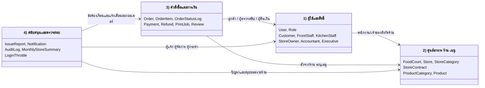
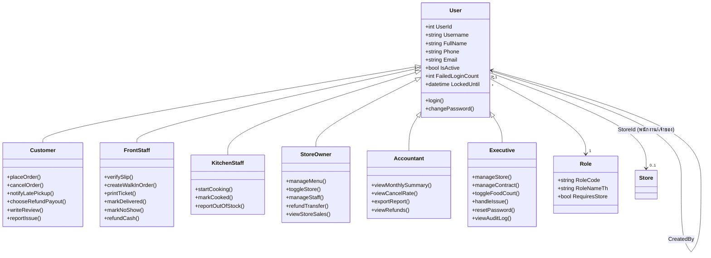
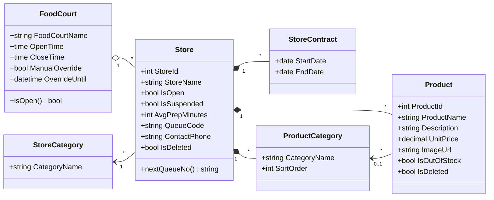
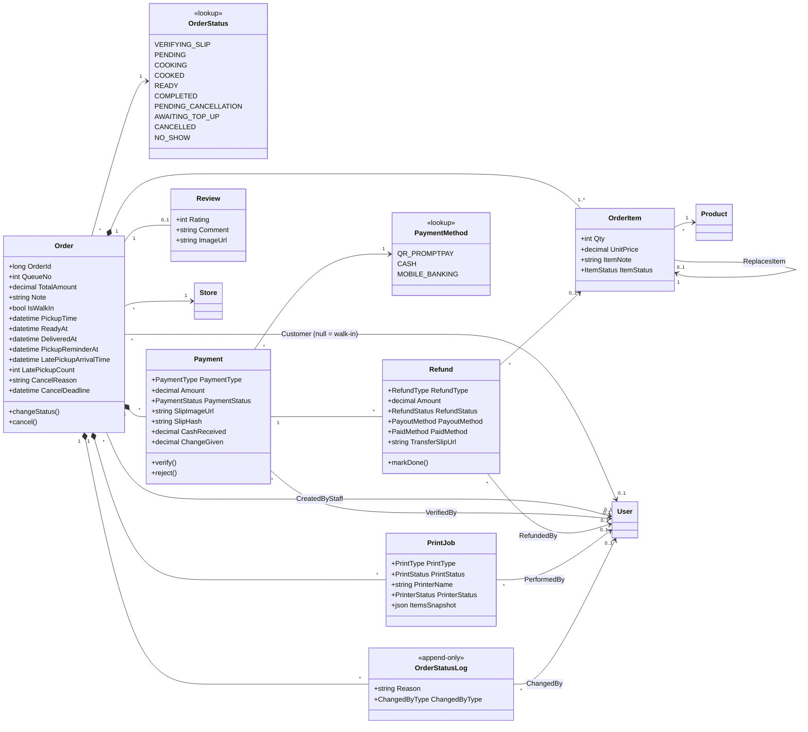
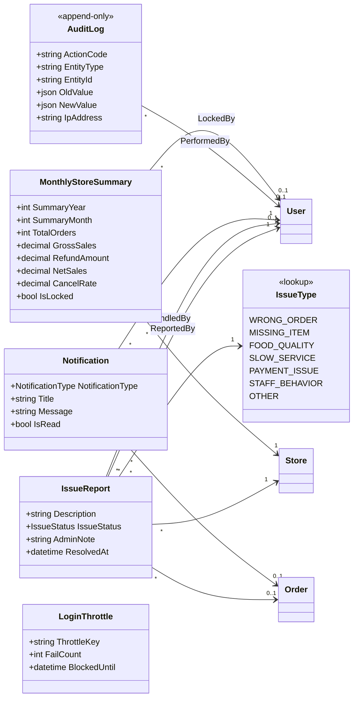
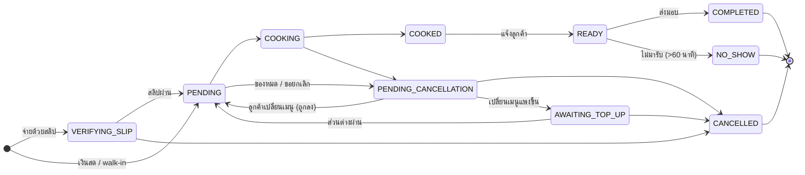

# Class Diagram — Only Foods (OFJA)

อิงจาก `database/init.sql` (ตารางจริงในระบบ) ; แสดงเฉพาะ attribute หลัก ไม่ใส่ timestamp/ฟิลด์ช่วยทางเทคนิค
User ทุกบทบาทอยู่ตารางเดียว (`User.RoleId`) แสดงเป็น generalization เพื่อให้เห็นว่าแต่ละบทบาททำอะไรได้

## 0) ภาพรวม (ระดับกลุ่มคลาส)

แต่ละกล่องคือกลุ่มคลาสที่แยกรายละเอียดไว้ในหัวข้อ 1–4 ; ลูกศรบอกว่ากลุ่มไหนอ้างอิงกลุ่มไหน

## 1) ผู้ใช้และสิทธิ์

## 2) ศูนย์อาหาร ร้าน และเมนู

## 3) คำสั่งซื้อ การชำระเงิน การคืนเงิน และการพิมพ์

## 4) ข้อร้องเรียน แจ้งเตือน รายงาน และ Audit

## 5) วงจรสถานะของ Order (`backend/state.py`)

ใช้ประกอบ Class Diagram ส่วนที่ 3 ; รายละเอียดทุกคู่สถานะดูที่ `state.py`

> ส่วนที่ 5 ตรวจเทียบกับตาราง `TRANSITIONS` ใน `state.py` แล้ว ; ข้อยกเว้นเดียวคือ `force_cancel` (ผู้บริหารปิดศูนย์อาหารแล้วเลือกยกเลิกทั้งหมด) ที่ข้ามตารางนี้ได้
